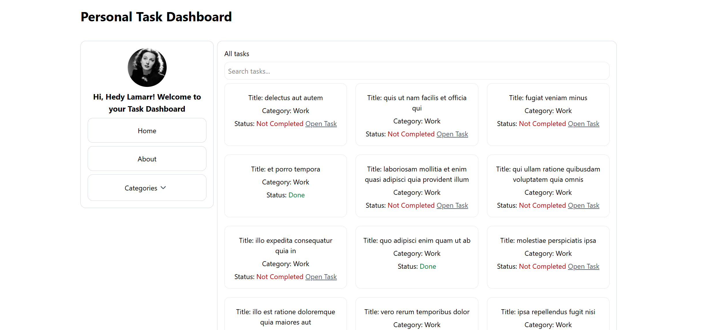
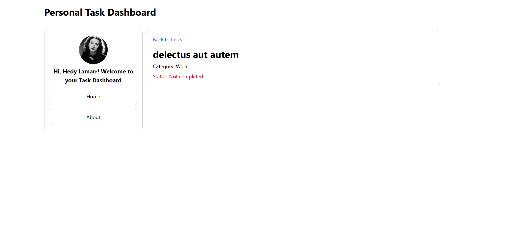
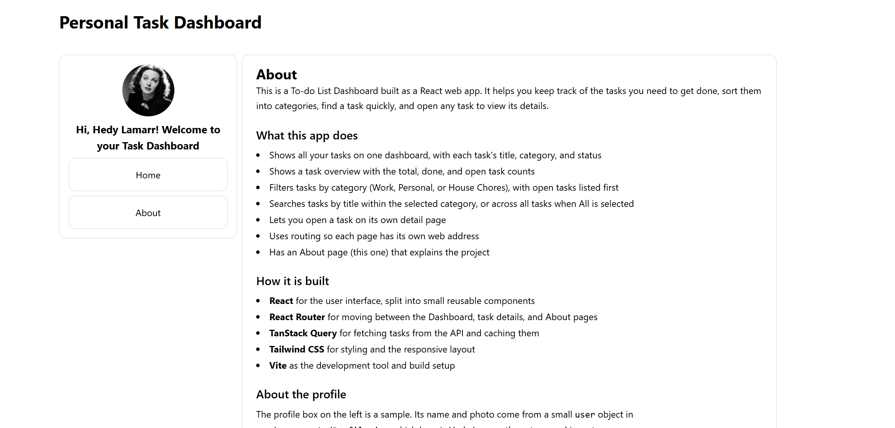

# To-do List Dashboard

A to-do list dashboard built with React. Browse tasks on a dashboard, filter them by category, search by title, open a task to see its details, and read the About page.

## Features

- **Dashboard** (`/`): lists tasks fetched from the [JSONPlaceholder](https://jsonplaceholder.typicode.com/todos) API. Each card shows the task's title, category, and status.
  - **Categories:** open the Categories menu and pick Work, Personal, or House Chores to see only that category's tasks, with open tasks listed first. Pick **All** to see every task again.
  - **Search:** type in the search bar to find tasks by title across all categories.
- **Task detail** (`/tasks/:id`): shows one task's title, category, and status based on the `id` in the URL. Open it with the **Open Task** link on any task that is not completed.
- **About** (`/about`): describes the app and its builder.

The API has no categories, so each category is a group of API user IDs, set in `src/components/Categories.jsx`.

### Public API

[JSONPlaceholder](https://jsonplaceholder.typicode.com/), a free fake REST API. No API key is needed.

- `GET https://jsonplaceholder.typicode.com/todos`: all 200 tasks, used on the Dashboard.
- `GET https://jsonplaceholder.typicode.com/todos/:id`: one task, used on the Task detail page.

### TanStack Query

All API data is fetched with TanStack Query's `useQuery`, not with `useState` and `useEffect`.

- **Dashboard** (`TaskList.jsx`) uses the query key `['tasks']` to fetch every task.
- **Task detail** (`TaskDetail.jsx`) uses the query key `['task', id]`, so each task id gets its own cache entry.
- Data stays fresh for 60 seconds (`staleTime: 60_000`), so going back to a page you just visited shows the cached data without fetching again.
- Failed requests are not retried (`retry: false`), so the error message appears right away.

The loading, error, and empty states come from what `useQuery` returns: `isLoading` shows the loading message, `isError` shows the error message, and the empty message is shown when there is no data to display.

### Loading, error, and empty states

- **Loading:** shown while tasks or a single task are being fetched.
- **Error:** shown when the API request fails. To see it, block requests to `jsonplaceholder.typicode.com` in your browser's developer tools (Network panel, "Block request domain"), then reload the page.
- **Empty:** type a search that matches no task, such as `zzz`, to see "No tasks found." Visit a task id that does not exist, such as `/tasks/9999`, to see "Task not found."

## Tech stack

- React 19
- React Router (routing)
- TanStack Query (server data fetching and caching)
- Tailwind CSS (styling)
- Vite (dev server and build)
- ESLint (linting)

## Setup

Requires Node.js 20.19 or newer (needed by Vite 8).

```bash
git clone https://github.com/rochellegarcia/AIM-mini-project-1.git
cd AIM-mini-project-1
npm install
npm run dev
```

Open the local address Vite prints in the terminal (usually `http://localhost:5173`).

## Live demo

https://aim-mini-project-1.vercel.app/

## Other scripts

```bash
npm run build    # production build into dist/
npm run preview  # preview the production build
npm run lint     # run ESLint
```

## Screenshots





## Project structure

```
src/
  App.jsx                    # route definitions
  main.jsx                   # providers: QueryClient and Router
  index.css                  # Tailwind CSS import
  components/
    TaskPage.jsx             # dashboard layout, categories menu, search bar
    TaskList.jsx             # fetches tasks, then filters, searches, and sorts them
    TaskRow.jsx              # one task card
    TaskDetail.jsx           # single task page (/tasks/:id)
    About.jsx                # about page
    Profile.jsx              # profile photo and greeting on the dashboard
    Categories.jsx           # category names and the user IDs in each
```
